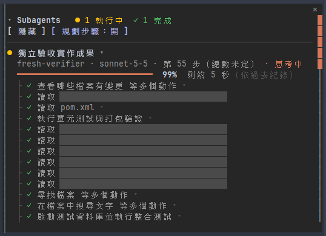
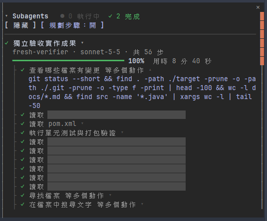

# subagent-panel

Claude Code mod：在側邊面板即時顯示這個 session 的每個 subagent。

| 執行中 | 完成（展開步驟可看原始指令） |
| --- | --- |
|  |  |

**步驟可以展開**：點有 ▾ 的步驟，就能看到它實際執行的指令，再點一次（▴）收合。右圖藍字就是「查看哪些檔案有變更」這一步展開後的內容。

截圖中的灰色色塊是遮蔽的檔名。

## 安裝

```
/plugin install subagent-panel --marketplace Jesse7073/claude-plugins
```

需要 Claude Code v2.1.287 以上。終端機要用全螢幕模式（`/tui fullscreen`）且寬度約 110 欄以上，面板才會停靠在對話旁邊；其他情況會顯示在輸入框上方。

## 面板顯示什麼

- **狀態**：執行中 ●、完成 ✓、中斷 ✗，標題列有各狀態的數量
- **在做什麼**：任務名稱，以及目前正在閱讀、修改檔案、執行指令、上網查資料或思考
- **用哪個模型**：每次實際送出請求時的模型
- **步驟**：樹狀清單，做完 ✓、進行中 ▶、還沒做 ○；步驟寫成白話句子，點一下展開實際動作與原始指令
- **進度與預估剩餘時間**：進度條、百分比與「剩約 X」，每分鐘重新估算；依據是 subagent 的計畫，或同類型 subagent 過去的平均（跨 session 保存在本機）

## 操作

- 呼叫 subagent 時面板自動出現
- **隱藏**：側邊欄縮成一條窄邊，只留「◂ 展開」；下一個 subagent 被呼叫時自動展開
- **✕**：清除某個 subagent 的紀錄
- **規劃步驟（預設開）**：在每個新 subagent 的指示尾端，要求它先用本 mod 提供的 `plan_steps`／`step_status` 工具列出並回報步驟，讓總步數與剩餘時間更準。會多用一些 token；關掉後改用工具呼叫次數計步
- 指令：`/subagents` 開啟面板，`/subagents clear` 清掉已結束的

## 隱私

面板、步驟判斷與剩餘時間都在本機計算，不另外呼叫模型、不連網路。
